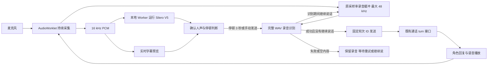

# 花期语音通话识别架构

通话输入由音频采集、实时字幕、轮次控制、整段录音识别和消息发送组成。**实时字幕仅用于预览，每轮必须用完整录音重新识别后才发送。** 识别失败不能用实时字幕代替。保留 Flask、既有通话记录和 ElevenLabs 配置，无新增常驻服务。

## 开源参照与实现边界

参考 [Pipecat User Turn Strategies](https://docs.pipecat.ai/api-reference/server/utilities/turn-management/user-turn-strategies) 的轮次策略划分，以及 [LiveKit Agents Turns](https://docs.livekit.io/agents/logic/turns/) 对 VAD、STT 断句和显式提交的区分。本项目采用独立采集与轮次控制器；当前用 [Silero V5](https://github.com/snakers4/silero-vad) 识别人声，以 [vad-web](https://github.com/ricky0123/vad) 的模型输入协议为参照。没有部署语义断句模型。

[ElevenLabs Scribe Realtime](https://elevenlabs.io/docs/api-reference/speech-to-text/v-1-speech-to-text-realtime) 的 `committed_transcript` 只说明某个字幕片段识别完成，不代表用户整句话结束。预览连接使用 `commit_strategy=vad`、1.5 秒服务端停顿阈值；最终轮次由本地 3 秒停顿判断及用户主动发送控制。

## 本次纠正

2026-10-30 首版误将实时最终结果作为直接发送依据，并将整段录音识别改成异常补救。用户实际反馈是字幕不准、漏字和短暂停顿抢发，因此撤销这两项策略。

- 每轮都用录音调用 Scribe v2，实时文字不进入发送接口。
- 最近声音或有效字幕变化后，安静满 3 秒才开始整段识别；服务端 final 不缩短等待。标点、重复 partial 不刷新期限。
- 整段识别期间继续录音。检测到继续说话就取消旧快照，保留前后两段及同一轮次 ID，再次停顿后识别完整录音。迟到结果被丢弃。字幕修正本身不取消请求，避免无限重复识别。
- 每次完整录音识别前后都有明确状态；失败或空内容保留录音重试，不自动连续重试，也不会降级发送字幕。

## 数据流



`static/call-audio-worklet.js` 每 100 ms 输出同步的预览 PCM 和录音 PCM，保留跨音频回调的采样余量。录音保存麦克风采样率（最大 48 kHz），避免整段识别复用降采样的实时流。`static/call-vad.js` 管理有界 Worker 队列，`static/call-vad-worker.js` 串行执行 Silero V5；32 ms 帧输出人声概率，使用采集时间戳而非推理完成时间。`static/call-speech.js` 管理连接、录音、`TurnDetector`、取消和生命周期。`templates/call.html` 展示预览、识别状态及重试，最终只发送录音识别结果。

## 等待和缓冲策略

| 情况 | 行为 |
| --- | --- |
| 一两秒句中停顿 / 收到字幕 final | 保留同一段，不发送 |
| 声音停止满 3 秒 | 识别本轮完整录音；若有较晚的新字幕，则从字幕变化时计时 |
| 没有实时文字或实时连接失败 | 录音继续，声音停止后仍可自动识别；也可以点击发送 |
| 识别时继续说话 | 取消旧请求，合并原录音；保留同一轮次 ID |
| 整段识别失败 / 无人声 | 保留录音，可重试或继续说；不发送预览文字 |
| 识别请求卡住 | 上传最多 60 秒，上传完成后识别响应最多 55 秒；服务端连接 5 秒、识别读取 45 秒；全流程 120 秒兜底 |
| 空闲预览连接失败 | 最多两次重连；随后独立录音仍可工作 |
| 录音满 90 秒 | 停止追加音频并显示提示，等待点击发送；不自动切句发送 |
| 发送失败 | 保留识别结果及 `client_turn_id`，重试复用 ID，不重复插入气泡 |

### 环境音修正

旧版音量阈值把底噪和碰麦声也当作补话，会不断刷新断句计时或取消录音识别。这部分已移除。

- 使用 Silero V5 人声概率：至少连续 160 ms 超过 0.65 才确认开始/补话，短促噪点不能累计成说话。已确认的人声有 160 ms 缓冲，概率低于 0.35 不延长最后说话时间；持续低于确认阈值也会释放确认状态。
- 环境音仍录入 WAV，但不直接增加轮次活动版本；只有确认的人声才取消自动识别快照。
- 录音识别返回后，最多等 400 ms 让已采集帧完成分类；短促疑似声音可自然消退，不重新调用识别。
- 手动发送/重试固定提交当前录音，后续人声和噪声都不取消这次显式提交。
- 模型资源和 ONNX Runtime 从同站固定版本目录加载；不依赖 CDN。包完整性、文件 SHA256、开源许可证见 `static/vendor/call-vad-20261030`。
- 模型加载期限 20 秒；推理队列最多 10 个 100 ms 包。加载失败、浏览器不兼容或推理积压时显示手动发送提示，不回退到音量阈值。推理异常不停止独立录音。

保留最多 10 秒前置录音；单轮含前置缓冲最长 90 秒，48 kHz 单声道 16 位 WAV 约 8.64 MB，在服务端 10 MB 上限内。VAD 能区别人声和部分常见环境音，但不能辨别附近的其他说话者；电视人声等仍可能被判为语音。


麦克风和 AudioWorklet 在多轮间复用。录音识别成功后暂停输入，生成回复和播放角色语音期间维持轮流说话；未实现播放中打断。静音、挂断或离开页面释放麦克风，内存录音随之清除。音频上传供识别，服务器代码不保存录音文件。

`epoch`、录音活动版本和取消信号隔离迟到结果。预览连接音频队列上限 8 秒，上传积压超过约 256 KB 关闭预览，独立录音不受影响。页面 `saki:call-stt-metrics` 事件记录来源 `batch_recording`、断句耗时及识别等待耗时，不包含原文或音频，也没有新增遥测上传。

## 验证与部署

```bash
node tests/test_voice_call_silence.cjs
SAKI_VAD_TEST_WAV=/path/to/public/test.wav node tests/voice_call_vad_browser.cjs
SAKI_VAD_TEST_WAV=/path/to/public/test.wav node tests/voice_call_pipeline_browser.cjs
SAKI_LOCAL_TEST=false SAKI_DATA_ROOT=/tmp/saki-call-tests KUNIGAMI_ENV=test ELEVENLABS_API_KEY=test-only \
  .venv/bin/python -m pytest -p no:cacheprovider \
  tests/test_voice_calls_api.py tests/test_voice_calls.py \
  tests/test_voice_call_frontend_regressions.py tests/test_voice_messages.py \
  tests/test_elevenlabs_client.py -q
```

2026-10-30 录音修正版：18 项 JS 测试、47 项 Python 测试通过。环境音修正版新增真实 Silero 模型回归，并将 JS 测试扩展为 25 项；Chromium 用真实 AudioWorklet、Silero Worker、公开语音样本和合成环境音验证通话流程。覆盖 16/44.1/48/96 kHz 采集、WAV 元数据、每轮整段识别、句中停顿、识别中继续说、无字幕、空结果/失败重试、多轮复用和挂断取消。浏览器脚本通过 `KUNIGAMI_PLAYWRIGHT_MODULE` 指定 Playwright，STT 和回复接口均为模拟，不会调用真实供应商；VAD 使用真实模型运行。公开测试语音来自 Silero 的 `tests/data/test.wav`，仅下载到临时目录，不使用用户录音。

测试中持续底噪、120 Hz 风扇声和短促碰麦声均没有启动轮次，或在录音识别中触发重试；语音结束后模型的残留活动仅约 32 ms。检查验证录音和发送控制，不能证明所有真实环境的识别准确率。中文/日语、轻声、手机、噪声和弱网仍需要真实通话验证。

本次部署包：`deploy/releases/saki-voice-recording-20261030`，仅替换通话模板、两个音频 JS、界面词典和识别路由，保存上线前备份并检查运行服务。新资源版本 `20261030b`，刷新页面并重新发起通话使用新流程。首版部署记录保留在 `deploy/releases/saki-voice-input-20261030`，其中描述的实时文字直发策略已由本次修正替代。

修正版已于 2026-10-30 21:27（北京时间）上线，21:28 公网验收通过，详见 [部署记录](deploy/releases/saki-voice-recording-20261030/DEPLOYMENT_ZH.md)。

环境音修正版部署包：`deploy/releases/saki-voice-vad-20261030`，资源版本 `20261030c`。新增的 Worker、运行时与模型须同包上线；刷新并重新发起通话生效。

环境音修正版已于 2026-10-30 21:57（北京时间）上线，公网浏览器实际模型验证通过。详见 [部署记录](deploy/releases/saki-voice-vad-20261030/DEPLOYMENT_ZH.md)。

2026-10-31 通话状态变更已与即时短期记忆整理解耦：创建/接通、挂断及检查旧断线通话不会提交整理任务，完整文字记录保留，正常定时和手动整理仍可读取。详见 [部署记录](deploy/releases/saki-call-memory-events-20261031/DEPLOYMENT_ZH.md)。


## 2026-11-01 录音上传与重试修正

原实现将上传和识别合在 25 秒总期限中，无法区分慢速上行与供应商识别超时。重试会重新截取不断增长的录音，长时间等待中的环境音也加入新上传。

现在通过 XHR 分别管理上传和识别响应，界面显示上传进度；失败保留录音，未继续说话时重试复用同一 Blob。手动发送固定当前录音并停止向该段追加音频，完成识别后仍使用原 client_turn_id 提交一次；空结果允许继续说话。自动识别时确认的后续人声仍能取消旧快照并合并全句。

实际 PWA 浏览器测试发现 Service Worker 的 fetch 转发使 XHR 上传进度事件消失。Worker 现在仅让同站通话录音 POST 直接交给浏览器；其他请求、离线提示和推送保留。通话页会检查已注册 Worker 的更新。

验证：31 项 JS、68 项 Python 回归；实际 Chromium + Silero + AudioWorklet 完整通话测试；安装 Worker 后以 32 KiB/s 上传约 1.15 MB 的合成录音，耗时 36.7 秒后成功识别并交付一次。另从生产服务器提交公开 Silero 语音的 5 秒片段，真实 Scribe 返回有效文本约 1.0 秒。没有读取用户录音或创建真实用户通话。以上验证不能复现用户手机当时的网络状态，不能据此断言截图中的超时只有单一原因。

发布包：`deploy/releases/saki-call-upload-20261101`，通话输入脚本版本 `20261101a`。

本次修复已于 2026-11-01 12:29（北京时间）上线，公网验收通过，详见 [部署记录](deploy/releases/saki-call-upload-20261101/DEPLOYMENT_ZH.md)。
