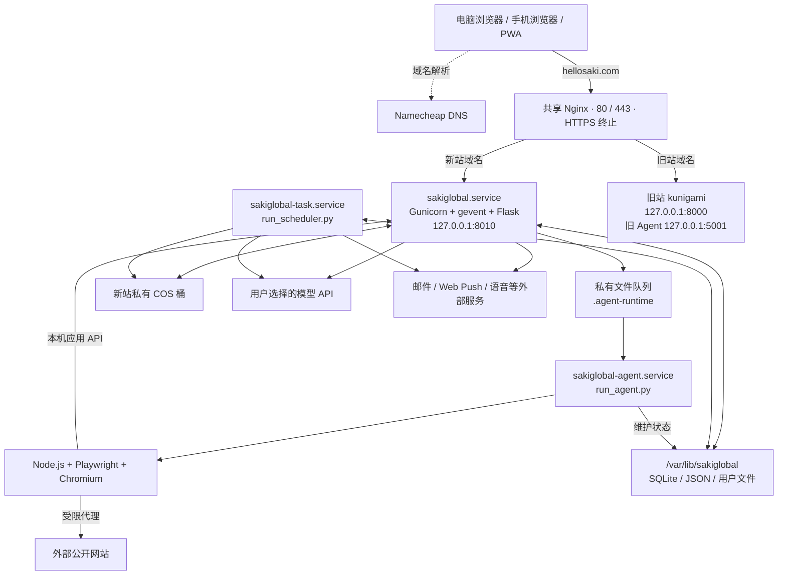

# 花期服务器架构与运维说明

花期的中文名是“花期”，日文名是“咲き”，英文名是“Saki”；源码目录与 systemd 服务继续使用 `sakiglobal`。正式入口是 **https://hellosaki.com**。应用采用同机运行的 Flask 网页服务、独立定时任务进程和独立浏览器 Agent，本地 SQLite/JSON 保存业务数据，腾讯云 COS 保存媒体资源。

这份说明用于日常维护、更新代码、排查故障及交接。整理日期为 **2026-10-16**：服务器部署参数依据此前 **2026-09-23** 回传的命令结果，功能实现对照当前本地源码。以下“部署记录”不是当前在线状态；文末提供重新核实命令。本地新增功能是否已上传，以服务器实际文件为准。

## 目录

- [整体架构](#整体架构)
- [服务器和新旧站隔离](#服务器和新旧站隔离)
- [域名入口和 HTTPS](#域名入口和-https)
- [三个应用服务](#三个应用服务)
- [目录和数据位置](#目录和数据位置)
- [外部服务与密钥](#外部服务与密钥)
- [典型请求如何运行](#典型请求如何运行)
- [日常运维命令](#日常运维命令)
- [更新和备份](#更新和备份)
- [常见故障定位](#常见故障定位)
- [线上配置复核与代码依据](#线上配置复核与代码依据)

## 整体架构



网页、定时任务和 Agent 都由 systemd 管理，使用同一份新站源码与业务数据。网页进程也会启动部分业务线程，例如生成内容和通话记忆处理；“后台任务服务”不代表所有后台工作都只在那一个进程里。因此完整停写、数据迁移或一致性备份时，应同时考虑这三个服务及人工运行的脚本。

PWA 是同一个网站的安装入口。当前 `static/manifest.json` 的名称和缩写都是 `Saki`；`static/sw.js` 处理推送、语言缓存与网络失败提示，没有提供完整离线聊天。

## 服务器和新旧站隔离

### 主机记录

| 项目 | 2026-09-23 部署记录 |
| --- | --- |
| 云服务商 | 腾讯云 |
| 主机名 | `VM-0-10-ubuntu` |
| 公网 IPv4 | `43.160.218.82` |
| 系统 | Ubuntu 24.04.4 LTS |
| CPU | 2 个逻辑 CPU |
| 内存和交换空间 | 约 3.6 GiB RAM、1.9 GiB Swap |
| 系统盘 | 约 59 GiB；可用空间随运行变化 |
| 管理账号 | `ubuntu`；应用服务使用 `www-data` 组 |
| Python | 3.12.3 |
| Nginx | 1.24.0 |
| Gunicorn | 新站安装时为 26.2.0 |
| Node.js | Agent 部署时为 22.22.2 |

新旧站共用这台机器的 CPU、内存、磁盘、网络和 Nginx。独立数据目录和桶能分开业务数据，但不会隔离主机资源消耗。旧站部署记录中有 10 个 Gunicorn worker，曾占用较多内存；这不是新站应该照搬的 worker 数量。

### 站点边界

| 项目 | 旧站 | 花期新站 |
| --- | --- | --- |
| 域名 | `kunigami-project-api.online` | `hellosaki.com` |
| 源码 | `/var/www/kunigami` | `/var/www/sakiglobal` |
| 数据根 | 旧部署记录为 `/var/www/kunigami` | `/var/lib/sakiglobal` |
| Python 环境 | 旧目录下 `venv/` | 新目录下 `venv/` |
| 网页服务 | `kunigami.service` | `sakiglobal.service` |
| 定时服务 | `kunigami-task.service` | `sakiglobal-task.service` |
| Agent 服务 | `kunigami-agent.service` | `sakiglobal-agent.service` |
| 网页监听 | `127.0.0.1:8000` | `127.0.0.1:8010` |
| Agent 入口 | 旧服务监听 `127.0.0.1:5001` | 由新站 Flask 接收请求，独立进程消费文件队列 |
| COS | 旧站桶 | 已部署为另一个独立桶，具体名称从受限配置读取 |
| 环境配置 | 旧 `.env` | 新 `.env`，不整份互相覆盖 |

新站维护命令应点名 `sakiglobal*` 服务。Nginx 为多个站点共享，配置修改要先检查整个 Nginx 配置，再 reload。历史上还存在 `sumikko` 站点配置，其当前用途不在这份部署记录中。

新旧站的账号 ID 属于不同账号库，数字相同不代表相同身份。用户迁移不能用旧库直接覆盖新库。

## 域名入口和 HTTPS

### DNS 和邮箱

Namecheap 管理 `hellosaki.com` 的 DNS。此前配置为：

| 记录 | 用途和部署值 |
| --- | --- |
| `A @` | `43.160.218.82`，网站指向这台服务器 |
| `CNAME www` | `hellosaki.com` |
| NS | `dns1.registrar-servers.com`、`dns2.registrar-servers.com` |
| MX | Namecheap Private Email 的 `mx1.privateemail.com` 和 `mx2.privateemail.com`，优先级均为 10 |
| SPF TXT | `v=spf1 include:spf.privateemail.com ~all` |

网站解析和邮箱解析承担不同用途。改网站 A/CNAME 时，应保留邮箱使用的 MX、SPF、DKIM、DMARC 等实际记录。此前收发邮件测试通过；当时未查到的 DKIM/DMARC 记录是否后来补齐，需要另行查询，不能从网站可访问推断邮箱认证配置完整。

### Nginx 和证书

已验证的入口行为：

- `https://hellosaki.com/login` 返回登录页。
- `http://hellosaki.com/` 跳转到 HTTPS。
- `https://www.hellosaki.com/` 跳转到主域名 `https://hellosaki.com/`。
- HTTP 的 `/.well-known/acme-challenge/` 保留给证书验证，文件根为 `/var/lib/sakiglobal-acme`。
- 新站动态请求转发至 `127.0.0.1:8010`。新站 `/api/run_agent` 同样走这个 Flask 入口，不套用旧站转发到 5001 的 location。

相关服务器文件：

```text
/etc/nginx/sites-available/sakiglobal
/etc/nginx/sites-enabled/sakiglobal
/etc/letsencrypt/live/hellosaki.com/fullchain.pem
/etc/letsencrypt/live/hellosaki.com/privkey.pem
/etc/letsencrypt/renewal/hellosaki.com.conf
/etc/letsencrypt/renewal-hooks/deploy/40-sakiglobal-nginx
/var/lib/sakiglobal-acme/.well-known/acme-challenge/
```

证书覆盖 `hellosaki.com` 与 `www.hellosaki.com`。此前已设置 Certbot 自动续期任务；续期部署钩子仅在这张证书更新时执行 `nginx -t` 和 Nginx reload，模拟续期已成功。证书当前有效期、定时器是否继续启用，以实时查询为准。

Nginx 当前上传限制、代理超时、缓冲和静态资源 location 未在此固化，避免把旧站配置当作新站配置。当前 Flask 源码限制请求体为 50 MiB；实际上传上限还受 Nginx 等上游限制。不能把 `/var/lib/sakiglobal` 直接配置为公开静态目录。

## 三个应用服务

### 网页服务 sakiglobal.service

负责登录、页面、聊天、群聊、朋友圈、论坛、广场、用户设置和授权媒体等 HTTP 请求。

部署记录中的启动命令：

```text
/var/www/sakiglobal/venv/bin/gunicorn --workers 1 --worker-class gevent --worker-connections 100 --timeout 300 --graceful-timeout 60 --bind 127.0.0.1:8010 --error-logfile - app:app
```

`app:app` 指向 `app.py` 中的 Flask 对象。部署时网页进程为 1 个 worker，避免在有限内存中叠加旧站和 Chromium 的资源压力。增加 worker 不只是改一个数字：需要同时评估内存、SQLite 写入、进程内状态和业务线程行为。

服务使用 `ubuntu:www-data`、`WorkingDirectory=/var/www/sakiglobal`、`UMask=0077`，日志进入 journal，失败后自动重启。生产模式由 `KUNIGAMI_ENV=production`、`SAKI_LOCAL_TEST=false`、`FLASK_DEBUG=false` 和 `SAKI_DATA_ROOT=/var/lib/sakiglobal` 明确指定。

正常正式运行使用 Gunicorn，不以 `python app.py` 或 `saki_local.py` 替代此服务。源码里的 Flask 开发入口端口与正式 8010 端口不是同一个配置来源。

### 定时任务 sakiglobal-task.service

运行 `/var/www/sakiglobal/venv/bin/python -u /var/www/sakiglobal/run_scheduler.py`，导入应用维护函数及 `memory_jobs.py`。它不提供独立 HTTP 接口。

**当前本地源码有 6 项任务**；最初部署日志为 5 项。第六项是否已上线，应查看服务器 `run_scheduler.py`。

| 任务 | 当前源码触发时间，Asia/Shanghai |
| --- | --- |
| 日维护 | 每天 04:00 |
| 年度年龄处理 | 每年 1 月 1 日 00:05 |
| 睡眠状态检查 | 每分钟 |
| 主动消息检查 | 每 10 分钟 |
| 主动朋友圈检查 | 每 30 分钟 |
| 通话记忆补录 | 每 5 分钟 |

检查任务不意味着每次都给每个用户发消息；是否执行具体动作还取决于用户和角色设置。定时器使用 2 个执行线程，单个任务限制最多同时运行 1 次，并用数据目录下 `.scheduler.lock` 防止同一数据根重复启动调度器。

触发时钟与页面时区分开：维护定时器保留 `Asia/Shanghai`，用户时间展示、记忆日期归属和角色 Prompt 时间由业务层按相应用户/角色设置处理。改变 UI 语言不应改变时区。

`--check` 只加载任务，不启动调度或执行任务；但它会导入应用，应用导入可能初始化表结构，因此不能把它当作严格无写入的数据库审计命令。

### 浏览器 Agent sakiglobal-agent.service

运行 `run_agent.py`，按需启动 Node.js 的 `agent-test/agent_universal.js`，再由 Playwright 启动 Chromium。`agent-test` 是沿用的目录名，这套脚本已经用于正式浏览器功能。

处理流程是：网页接口校验当前用户和角色，将任务写入私有文件队列；Agent 读取任务；浏览器通过受限代理访问公开网站，并由 Node 进程调用本机新站聊天 API 获取角色回复。应用会话不放入外部网站的浏览器上下文。

当前源码和仓库服务文件的限制：

| 项目 | 配置 |
| --- | --- |
| 同时运行任务 | 每个数据根最多 1 个 |
| 单次时长 | 最多 900 秒，包含等待用户的时间 |
| 单次步骤 | 最多 50 步 |
| 内部应用 API | `http://127.0.0.1:8010` |
| Chromium 缓存 | `/home/ubuntu/.cache/ms-playwright` |
| 内存 | `MemoryHigh=512M`、`MemoryMax=768M` |
| CPU | `CPUQuota=100%`，最多约一个逻辑 CPU 的配额 |
| systemd 隔离 | `NoNewPrivileges`、只读系统、私有临时目录等 |
| 可写业务根 | `/var/lib/sakiglobal` |
| 显式禁止读取 | `/var/www/kunigami`、新站 `.env` |

Agent 没有固定的独立公网 API 监听端口；浏览代理使用本机临时监听。外部浏览限制为公开 HTTP/HTTPS 目标，不允许私网目标，下载、额外弹窗和网站 Service Worker 被禁用。

启动前 `ExecStartPre` 会执行 `run_agent.py --check`，实际启动 Chromium 并验证私网访问拦截。此检查不调用模型，不创建任务或聊天。Chromium 缺失、权限问题或 Node 依赖不匹配都会使服务启动失败。

`.agent-runtime` 保存队列、锁与心跳，任务中会短暂存放应用会话 Cookie，应保持私有。服务重启会清理未完成队列/状态，不能保证正在浏览的任务续跑。Node 子进程只接收限定环境变量，不需要整份应用 `.env`。

## 目录和数据位置

### 源码与运行数据分离

```text
/var/www/sakiglobal/                 源码及运行依赖
├── app.py                          Flask 应用入口
├── blueprints/                     HTTP 路由和业务入口
├── core/                           配置、账号、权限、语言、时间、队列等
├── services/                       模型调用、记忆、语音、浏览代理等
├── templates/                      HTML 模板
├── static/                         CSS、JS、三语资源、PWA 文件
├── run_scheduler.py                定时任务入口
├── run_agent.py                    浏览器后台入口
├── agent-test/                     浏览器脚本、package-lock、node_modules
├── scripts/                        维护与迁移脚本
├── deploy/                         部署文件与文档
├── venv/                           服务器 Python 虚拟环境
└── .env                            新站秘密配置，不公开

/var/lib/sakiglobal/                 正式业务数据
├── configs/                        全站账号、论坛、广场等数据库
├── users/<uid>/                    按账号分开的个人资料
├── stickers/                       表情包资料及 meta.json
├── .agent-runtime/                 私有 Agent 队列、锁和心跳
├── .scheduler.lock                 单调度器锁文件
└── migration-backups/              部分迁移的私有暂存和恢复资料

/var/backups/sakiglobal/             管理员私有备份
/var/lib/sakiglobal-acme/            证书验证文件，与用户数据分开
```

源码升级主要修改 `/var/www/sakiglobal`。聊天和账号不应靠覆盖源码目录来更新；`SAKI_DATA_ROOT` 指向 `/var/lib/sakiglobal`，不要误改到旧站目录或本地测试目录。

### 重要业务数据

| 内容 | 新站相对数据根的位置 |
| --- | --- |
| 账号、密码哈希、会话版本、条款确认 | `configs/users.db` |
| 角色广场、作者关联、互动、试聊 | `configs/square.db` |
| 论坛与论坛背景 | `configs/forums.db`；`forums`、`forum_backgrounds` |
| 生图日用量与预占 | `configs/image_usage.db` |
| 设备账号记录与推送订阅 | `configs/device_accounts.json`、`configs/subscriptions.json` |
| 个人设置、角色/群组索引 | `users/<uid>/configs/` |
| 个人模型配置 | `users/<uid>/configs/api_settings.json` |
| 个人加密 API Key | `users/<uid>/configs/credentials.json` |
| 私聊 | `users/<uid>/characters/<char_id>/chat.db` |
| 人设、关系、记忆和日程 | 对应角色的 `prompts/` 及实际业务文件 |
| 群聊 | `users/<uid>/groups/<group_id>/chat.db` 及其记忆文件 |
| 朋友圈 | `users/<uid>/configs/moments_data.json` 等 |
| 语音消息索引 | `users/<uid>/voice_messages/media.db` |
| 通话状态与文字记录 | `users/<uid>/voice_calls/calls.db` |
| 表情包归属等元数据 | `stickers/<pack_id>/meta.json` |

表和字段可能随源码版本演进；数据库文件路径相同，不等于 schema 永远相同。论坛、广场和公共表情包不在单个 `users/<uid>` 目录中，只复制个人目录会漏掉它们。

### COS 媒体与访问控制

新站 COS 与旧站使用不同桶，个人对象按 `users/<uid>/...` 划分。广场共享头像使用 `square/avatars/...`，共用表情资源使用 `stickers/...`。完整桶名和云凭证留在受限配置里，不写进公开文档。

浏览器通常通过新站 `/api/media/cos/<对象 key>` 读取配置桶内的媒体。Flask 校验登录状态与对象前缀，再认证读取 COS 并流式返回；对个人媒体和响应地址改写使用私有、不缓存策略。

- 未登录请求返回 401。
- 当前账号只能读取自己的 `users/<uid>/` 对象；共享前缀允许已登录用户读取。
- 越权或不合法对象路径返回 404，避免通过响应暴露他人资源。
- 广场头像应有独立共享副本，不能直接使用作者个人私有前缀。

直接打开私有桶 URL 出现 403 不等于文件丢失。此前还出现过认证 HEAD 403、认证 GET 成功，当前媒体实现包含回退处理。排查应检查应用入口和实际 GET，不应为了显示头像而把整个桶设为公开。

## 外部服务与密钥

`core/runtime.py` 读取源码根的 `.env`，并保留进程环境变量的优先级。因此 systemd 的 Environment 可以覆盖同名 `.env` 配置。Agent 自身不导入这套完整环境，使用服务文件指定的路径，并通过网页 API 使用模型能力。

| 配置或服务 | 职责 |
| --- | --- |
| `FLASK_SECRET_KEY` | 签名 Flask 登录会话；不是用户 API Key 的加密钥匙 |
| `CREDENTIAL_ENCRYPTION_KEYS` | Fernet 密钥列表，用于解密/加密个人 API Key；新加密使用第一把 |
| `SAKI_ADMIN_USER_IDS` | 明确列出的管理员 ID；留空表示没有管理员，不固定为用户 1 |
| `COS_SECRET_ID`、`COS_SECRET_KEY`、地域和桶配置 | 服务端访问新站 COS |
| `MAIL_*` | 找回密码及邮件通知所用 SMTP；代码使用 SMTP SSL |
| `VAPID_*` | 浏览器 Web Push 通知；订阅还涉及浏览器推送服务 |
| 个人提供商 Key | 个人模型线路、TTS 等按业务路由使用，存于个人加密文件 |
| `SAKI_SERVICE_GEMINI_API_KEY` | 代码中显式选择服务 Key 的公共功能，是否线上启用取决于配置 |
| 平台 `ELEVENLABS_API_KEY` | 当前语音识别 STT 相关能力；角色 TTS/克隆采用用户个人凭证 |
| 搜索、天气等 | 由相应业务模块访问外部 API；是否可用取决于有效配置与外部服务状态 |

模型线路在当前代码中包含 Gemini、ChatGPT、Claude、Grok 和自填写地址，按聊天、翻译、识图、人设、通话、朋友圈、记忆、生图、论坛配置模型。通常由后端向所选提供商或自定义地址发请求，前端不直接读取服务端保存的 Key。旧代码中的 `openrouter` 命名仍有兼容用途，不代表线上必须有一个名为 relay 的独立服务。

备份数据时必须同时能恢复所需的密钥，但秘密文件应单独受限保存。重新生成加密钥匙而不迁移密文会导致原用户凭证无法解密；复制旧站 `.env` 又可能让新站连接回旧桶或覆盖现有配置。

## 典型请求如何运行

**打开网站和聊天。** 浏览器访问域名，Nginx 处理 HTTPS 并转给 8010 上的 Flask。Flask 验证会话、定位当前用户和角色，读取配置及聊天/记忆，按用户所选线路调用模型，保存业务结果并返回页面或接口响应。

**显示图片或语音媒体。** 浏览器请求同源授权媒体入口，Flask 验证账号能否访问该 key，向私有 COS 发起认证请求并返回数据。数据库中的旧地址、桶中是否真的存在对象、应用权限三者都影响能否显示。

**主动消息和主动朋友圈。** 独立调度器定期检查用户与角色设置，调用共用业务函数和模型，写入个人数据，并在条件满足时发邮件或 Web Push。网页正常可打开不代表调度器正常。

**阅读网站。** 登录用户在聊天中提交网址，Flask 创建任务；Agent 执行浏览，并通过本机新站聊天接口沿用该用户角色、模型和存储逻辑。重启网页可能中断模型调用，重启 Agent 会中断浏览任务。

## 日常运维命令

以下命令在服务器 TAT/SSH 终端运行；仅供运营者需要时执行，本次编写文档没有运行这些生产操作。

### 查看状态和资源

```bash
sudo systemctl show sakiglobal.service sakiglobal-task.service sakiglobal-agent.service --no-pager -p Id -p ActiveState -p SubState -p NRestarts -p MemoryCurrent
sudo ss -lntp
free -h
df -h /var/www /var/lib/sakiglobal
```

内存看 `available`、Swap 变化、服务内存和重启次数，不仅看 `free` 一列。`active` 说明进程在运行，仍需检查业务响应。

### 查看日志

```bash
sudo journalctl -u sakiglobal.service -n 80 --no-pager -o cat
sudo journalctl -u sakiglobal-task.service -n 80 --no-pager -o cat
sudo journalctl -u sakiglobal-agent.service -n 80 --no-pager -o cat
```

持续查看网页日志，按 Ctrl+C 退出查看，不会停止服务：

```bash
sudo journalctl -u sakiglobal.service -f
```

Nginx 的具体日志文件以有效配置为准；常见默认位置是 `/var/log/nginx/access.log` 和 `/var/log/nginx/error.log`。分享日志前检查其中是否包含账号、网址参数或个人内容。

### 网页健康检查

```bash
curl --noproxy '*' --max-time 20 -sS -o /dev/null -w '本机登录页 HTTP %{http_code}\n' -H 'Host: hellosaki.com' http://127.0.0.1:8010/login
curl --noproxy '*' --max-time 20 -sS -o /dev/null -w '公网登录页 HTTP %{http_code}\n' https://hellosaki.com/login
curl --noproxy '*' --max-time 20 -sS -o /dev/null -w '未登录媒体 HTTP %{http_code}\n' https://hellosaki.com/api/media/cos/users/1/avatar.png
```

正常入口预期为 200、200、401。最后一个请求只验证未登录被拦截，不证明头像对象存在或登录后可读取。用户数据验收仍需真实登录。

### 重启和维护停机

只更新模板/页面相关代码时，通常重启网页服务即可使 worker 加载新内容：

```bash
sudo systemctl restart sakiglobal.service
```

共用 Python 模块可能同时被网页、调度器和 Agent 使用。完整维护窗口中可以按以下顺序停下、更新并恢复；恢复时应尊重维护前的服务状态：

```bash
sudo systemctl stop sakiglobal-agent.service sakiglobal-task.service sakiglobal.service
```

更新和校验完成后，先恢复网页，再恢复其他原先运行的服务：

```bash
sudo systemctl start sakiglobal.service
sudo systemctl start sakiglobal-task.service sakiglobal-agent.service
```

更新 systemd unit 文件后先运行 `sudo systemctl daemon-reload`；单纯修改 Python、HTML 或 `.env` 不需要 daemon-reload，但相关常驻进程需要重启才能重新加载。恢复调度器后可能产生主动消息和模型用量，维护期间运行中的通话、生成和浏览任务也可能中断。

### Nginx 和证书

Nginx 配置编辑完成后，只有检查成功才 reload：

```bash
sudo nginx -t && sudo systemctl reload nginx
```

查看证书和续期定时器：

```bash
sudo certbot certificates
systemctl list-timers --all --no-pager | grep -Ei 'certbot|letsencrypt'
```

需要验证续期链路时，可单独进行模拟续期；它会访问 ACME 测试服务，并运行本地部署钩子，不是纯本地只读检查：

```bash
sudo certbot renew --cert-name hellosaki.com --dry-run --run-deploy-hooks
```

## 更新和备份

源码、业务数据、密钥、服务器配置和 COS 是不同恢复对象。只备份项目源码，无法恢复用户聊天；只备份 `users/`，又会漏掉账号库、论坛、广场、表情包归属和云端图片。

| 恢复对象 | 应保存的内容 |
| --- | --- |
| 应用版本 | 实际线上源码、依赖清单和锁文件、更新前版本信息 |
| 本地业务 | `/var/lib/sakiglobal` 中个人资料和全局数据库，按一致性方式取得 |
| 秘密配置 | 新站 `.env` 及必要的密钥，单独限制访问 |
| 服务和入口 | `/etc/systemd/system/sakiglobal*.service`、Nginx 站点配置、证书续期配置/钩子 |
| 云端媒体 | COS 对象备份或经核实可恢复的版本策略；不能假定已开启版本控制 |

目前有此前手动迁移/维护产生的备份目录；是否已经建立每日自动备份、异地副本及恢复演练，尚无线上记录确认。没有确认前，不应把“有 backups 目录”写成“已自动备份”。

建议按下面顺序更新：

1. 明确本次文件范围和受影响服务，记录线上版本与原服务状态。 发布包上传前执行 [发布前检查](../CONTRIBUTING.md#6-发布与线上验收)，通过后再进入安装。
2. 备份对应源码；涉及数据结构或迁移时，停止全部相关写入者后制作 SQLite/文件一致性备份。运行中直接复制单个 `.db` 可能遗漏 WAL 数据。
3. 通过 WinSCP 上传已检查的源码。保留服务器 `.env`、`venv/` 和业务数据；不要把本地测试数据或整棵 `node_modules` 拖上去。
4. 依赖改变时，在新站自己的虚拟环境或 `agent-test` 目录安装，不操作旧站环境。需要锁定版本以便复现；当前 Python requirements 并未全部固定版本。
5. 用对应检查确认导入和浏览器启动，再重启受影响服务。`run_scheduler.py --check` 会加载应用，不当作数据审计工具。
6. 检查登录、关键接口、账号数据、图片、后台日志和资源占用，保留可回退版本。

回退代码和回退数据应分开处理。新站恢复使用后直接覆盖整库旧备份，会丢失其他用户后续写入。用户迁移与补迁按 [迁移 SKILL](../skills/sakiglobal-user-migration/SKILL.md)及其分步手册操作，不能直接套用写死用户 1 的历史脚本。

## 常见故障定位

| 现象 | 优先检查 |
| --- | --- |
| 域名打不开，服务器本机 8010 正常 | DNS A/AAAA、Nginx、证书、安全组、代理/VPN；不要先重装应用 |
| Nginx 返回 502 | 新站服务状态、8010 是否监听、Gunicorn 错误日志；确认没有转到旧站端口 |
| 网页正常但主动功能不工作 | `sakiglobal-task`、用户/角色开关、模型凭证、睡眠时间和任务日志 |
| 浏览网页功能启动失败 | `sakiglobal-agent` 的启动前检查、Playwright/Chromium、权限、内存和网页服务是否可达 |
| 浏览任务显示忙或中断 | 当前单任务槽、服务心跳、15 分钟/50 步限制；不要公开队列文件里的 Cookie |
| 头像 403 或应用媒体 502 | 新桶配置、对象 key、授权 GET 和应用媒体入口；区分私有桶拒绝与对象缺失 |
| 聊天迁来但论坛/广场为空 | 它们在全局数据库；只迁个人目录不包含这些记录 |
| 联系人框架可见但列表失败 | 联系人接口、浏览器控制台及已读同步；此前曾有本地已读 ID 超过服务端消息范围的问题，不能直接认定聊天丢失 |
| 手机旧界面、电脑新界面 | 实际上传文件、模板版本、浏览器/PWA 缓存和 Service Worker；先保留本地未同步状态再针对性处理 |
| WinSCP/SSH 超时 | 服务监听、安全组当前公网来源 IP、VPN/网络路径；TAT 可用不代表公网 22 端口可达 |
| gevent worker 无法加载 | 异常中缺失的 Python 依赖；此前缺过 `packaging`，当前 requirements 已加入 |
| 服务频繁重启或任务被杀 | `NRestarts`、内存限制、系统 OOM、journal；同机旧站也会消耗资源 |

## 线上配置复核与代码依据

维护者接手或完成较大更新后，可运行下面的查询，更新这份文档中的历史部署参数。配置输出可能含内部路径；分享前仍需检查，尤其不要贴出 `.env` 和私钥。

```bash
sudo systemctl show sakiglobal.service sakiglobal-task.service sakiglobal-agent.service --no-pager -p Id -p FragmentPath -p User -p Group -p WorkingDirectory -p ExecStart -p ActiveState -p SubState
sudo cat /etc/nginx/sites-available/sakiglobal
sudo nginx -t
dig +noall +answer hellosaki.com A
dig +noall +answer hellosaki.com AAAA
dig +noall +answer www.hellosaki.com CNAME
```

需对照线上确认的重点：三个 unit 的实际参数和资源限制、有效数据根、新旧桶仍保持分开、调度器是否已升级为 6 项、证书自动续期与备份任务是否正常。当前仓库只保存了 Agent unit 模板，网页/调度器 unit 和 Nginx 完整配置仍以服务器文件为准。

本地实现依据：

- [品牌名称](../core/branding.py)、[环境与数据根](../core/runtime.py)、[配置检查](../core/environment_check.py)。
- [网页入口](../app.py)、[定时器](../run_scheduler.py)、[Agent 入口](../run_agent.py)、[Agent 服务文件](sakiglobal-agent.service)。
- [Agent 队列](../core/web_agent.py)、[浏览代理](../services/agent_proxy.py)、[浏览器脚本](../agent-test/agent_universal.js)。
- [路径配置](../core/config.py)、[个人凭证](../core/credentials.py)、[私有媒体](../core/private_media.py)、[管理员规则](../core/admin_permissions.py)。
- [模型配置](../core/model_settings.py)、[模型协议适配](../services/model_provider.py)、[论坛数据](../blueprints/forum.py)、[朋友圈数据](../blueprints/moments.py)。
- [Agent 部署步骤](../AGENT_DEPLOYMENT_ZH.md)、[独立本地环境](../LOCAL_DEVELOPMENT_ZH.md)、[用户迁移手册](../skills/sakiglobal-user-migration/references/user-891-to-7.md)。
